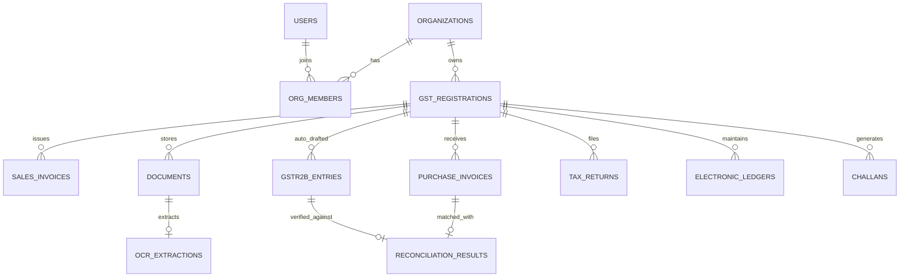

# SimpleGST Relational Data Model Specification

## 1. Database Architecture
SimpleGST utilizes a persistent relational SQLite database engine located at `data/simplegst.db`, managed via Node.js native `node:sqlite` (`DatabaseSync`).

### Key Design Principles:
- **Tenant Isolation**: Every financial and compliance table enforces `org_id` and `gstin_id` foreign keys with appropriate composite indexes.
- **ACID Transactions**: Financial operations (tax offsets, challan credits, invoice approvals) execute within transactional boundaries (`db.exec('BEGIN IMMEDIATE')`).
- **Mathematical Integrity**: Monetary amounts are stored as integer/real numbers with strict non-negative constraints where required by statutory law.
- **Audit Logging**: Immutable historical tracking for every critical tax, filing, and ledger modification.

---

## 2. Entity-Relationship Schema



---

## 3. Schema Definitions

### 3.1 Organization & Multi-GSTIN Entities
```sql
CREATE TABLE IF NOT EXISTS organizations (
    id TEXT PRIMARY KEY,
    name TEXT NOT NULL,
    pan TEXT NOT NULL,
    legal_type TEXT DEFAULT 'Private Limited Company',
    registered_address TEXT,
    state TEXT,
    created_at DATETIME DEFAULT CURRENT_TIMESTAMP
);

CREATE TABLE IF NOT EXISTS org_members (
    id TEXT PRIMARY KEY,
    org_id TEXT NOT NULL REFERENCES organizations(id) ON DELETE CASCADE,
    user_id TEXT NOT NULL REFERENCES users(id) ON DELETE CASCADE,
    role TEXT CHECK(role IN ('OWNER', 'CA', 'ACCOUNTANT', 'AUDITOR')) DEFAULT 'OWNER',
    created_at DATETIME DEFAULT CURRENT_TIMESTAMP,
    UNIQUE(org_id, user_id)
);

CREATE TABLE IF NOT EXISTS gst_registrations (
    id TEXT PRIMARY KEY,
    org_id TEXT NOT NULL REFERENCES organizations(id) ON DELETE CASCADE,
    gstin TEXT UNIQUE NOT NULL,
    trade_name TEXT NOT NULL,
    state_code TEXT NOT NULL,
    state_name TEXT NOT NULL,
    address TEXT,
    jurisdiction TEXT,
    is_active INTEGER DEFAULT 1,
    is_primary INTEGER DEFAULT 0,
    filing_frequency TEXT CHECK(filing_frequency IN ('MONTHLY', 'QRMP')) DEFAULT 'MONTHLY',
    created_at DATETIME DEFAULT CURRENT_TIMESTAMP
);
```

### 3.2 Sales & Purchase Invoices
```sql
CREATE TABLE IF NOT EXISTS sales_invoices (
    id TEXT PRIMARY KEY,
    org_id TEXT NOT NULL REFERENCES organizations(id),
    gstin_id TEXT NOT NULL REFERENCES gst_registrations(id),
    period TEXT NOT NULL, -- e.g. '102026'
    invoice_number TEXT NOT NULL,
    invoice_date DATE NOT NULL,
    customer_name TEXT NOT NULL,
    customer_gstin TEXT,
    pos TEXT NOT NULL,
    is_interstate INTEGER DEFAULT 0,
    supply_type TEXT CHECK(supply_type IN ('B2B', 'B2CL', 'B2CS', 'EXPORT_WPAY', 'EXPORT_WOPAY', 'SEZ_WPAY', 'SEZ_WOPAY', 'NIL_EXEMPT')) DEFAULT 'B2B',
    taxable_amount REAL NOT NULL CHECK(taxable_amount >= 0),
    gst_rate REAL NOT NULL,
    igst REAL DEFAULT 0,
    cgst REAL DEFAULT 0,
    sgst REAL DEFAULT 0,
    cess REAL DEFAULT 0,
    total_tax REAL NOT NULL,
    total_amount REAL NOT NULL,
    status TEXT CHECK(status IN ('DRAFT', 'VALIDATED', 'FILED')) DEFAULT 'VALIDATED',
    created_at DATETIME DEFAULT CURRENT_TIMESTAMP,
    UNIQUE(gstin_id, invoice_number)
);

CREATE TABLE IF NOT EXISTS purchase_invoices (
    id TEXT PRIMARY KEY,
    org_id TEXT NOT NULL REFERENCES organizations(id),
    gstin_id TEXT NOT NULL REFERENCES gst_registrations(id),
    period TEXT NOT NULL,
    invoice_number TEXT NOT NULL,
    invoice_date DATE NOT NULL,
    supplier_name TEXT NOT NULL,
    supplier_gstin TEXT NOT NULL,
    pos TEXT NOT NULL,
    is_interstate INTEGER DEFAULT 0,
    is_rcm INTEGER DEFAULT 0,
    taxable_amount REAL NOT NULL CHECK(taxable_amount >= 0),
    gst_rate REAL NOT NULL,
    igst REAL DEFAULT 0,
    cgst REAL DEFAULT 0,
    sgst REAL DEFAULT 0,
    cess REAL DEFAULT 0,
    total_tax REAL NOT NULL,
    total_amount REAL NOT NULL,
    itc_eligibility TEXT CHECK(itc_eligibility IN ('ELIGIBLE', 'INELIGIBLE_17_5', 'INELIGIBLE_OTHER')) DEFAULT 'ELIGIBLE',
    blocked_reason TEXT,
    payment_status TEXT CHECK(payment_status IN ('UNPAID', 'PARTIALLY_PAID', 'FULLY_PAID')) DEFAULT 'UNPAID',
    payment_date DATE,
    amount_paid REAL DEFAULT 0,
    days_aging INTEGER DEFAULT 0,
    rule37_interest REAL DEFAULT 0,
    status TEXT DEFAULT 'VALIDATED',
    created_at DATETIME DEFAULT CURRENT_TIMESTAMP,
    UNIQUE(gstin_id, invoice_number, supplier_gstin)
);
```

### 3.3 Documents, OCR & File Storage
```sql
CREATE TABLE IF NOT EXISTS documents (
    id TEXT PRIMARY KEY,
    org_id TEXT NOT NULL REFERENCES organizations(id),
    gstin_id TEXT NOT NULL REFERENCES gst_registrations(id),
    category TEXT NOT NULL, -- 'sales_invoice', 'purchase_bill', 'bank_statement', 'gstr2b_import'
    original_filename TEXT NOT NULL,
    stored_filename TEXT NOT NULL,
    file_type TEXT NOT NULL,
    file_size_bytes INTEGER NOT NULL,
    storage_path TEXT NOT NULL,
    status TEXT CHECK(status IN ('UPLOADED', 'PROCESSING', 'PARSED', 'APPROVED', 'FAILED')) DEFAULT 'UPLOADED',
    created_at DATETIME DEFAULT CURRENT_TIMESTAMP
);

CREATE TABLE IF NOT EXISTS ocr_extractions (
    id TEXT PRIMARY KEY,
    document_id TEXT NOT NULL REFERENCES documents(id) ON DELETE CASCADE,
    raw_text TEXT,
    extracted_fields_json TEXT NOT NULL,
    confidence REAL DEFAULT 0.95,
    status TEXT CHECK(status IN ('PENDING_REVIEW', 'APPROVED', 'REJECTED')) DEFAULT 'PENDING_REVIEW',
    approved_at DATETIME,
    approved_by TEXT REFERENCES users(id)
);
```

### 3.4 GSTR-2B & Reconciliation Engine
```sql
CREATE TABLE IF NOT EXISTS gstr2b_entries (
    id TEXT PRIMARY KEY,
    gstin_id TEXT NOT NULL REFERENCES gst_registrations(id),
    period TEXT NOT NULL,
    supplier_gstin TEXT NOT NULL,
    supplier_name TEXT NOT NULL,
    invoice_number TEXT NOT NULL,
    invoice_date DATE NOT NULL,
    taxable_value REAL NOT NULL,
    igst REAL DEFAULT 0,
    cgst REAL DEFAULT 0,
    sgst REAL DEFAULT 0,
    cess REAL DEFAULT 0,
    filing_date DATE,
    itc_available TEXT DEFAULT 'Y',
    created_at DATETIME DEFAULT CURRENT_TIMESTAMP
);

CREATE TABLE IF NOT EXISTS reconciliation_results (
    id TEXT PRIMARY KEY,
    gstin_id TEXT NOT NULL REFERENCES gst_registrations(id),
    period TEXT NOT NULL,
    purchase_invoice_id TEXT REFERENCES purchase_invoices(id),
    gstr2b_id TEXT REFERENCES gstr2b_entries(id),
    match_status TEXT CHECK(match_status IN ('MATCHED', 'MISMATCH_TAX', 'MISSING_IN_2B', 'BLOCKED_17_5')) NOT NULL,
    variance_amount REAL DEFAULT 0,
    notes TEXT,
    updated_at DATETIME DEFAULT CURRENT_TIMESTAMP
);
```

### 3.5 Ledgers, Challans & Statutory Returns
```sql
CREATE TABLE IF NOT EXISTS electronic_ledgers (
    id TEXT PRIMARY KEY,
    gstin_id TEXT NOT NULL REFERENCES gst_registrations(id),
    ledger_type TEXT CHECK(ledger_type IN ('CASH', 'CREDIT', 'LIABILITY')) NOT NULL,
    head TEXT CHECK(head IN ('IGST', 'CGST', 'SGST', 'CESS')) NOT NULL,
    sub_head TEXT CHECK(sub_head IN ('TAX', 'INTEREST', 'PENALTY', 'FEES', 'OTHER')) DEFAULT 'TAX',
    balance REAL DEFAULT 0,
    updated_at DATETIME DEFAULT CURRENT_TIMESTAMP,
    UNIQUE(gstin_id, ledger_type, head, sub_head)
);

CREATE TABLE IF NOT EXISTS challans (
    id TEXT PRIMARY KEY,
    gstin_id TEXT NOT NULL REFERENCES gst_registrations(id),
    period TEXT NOT NULL,
    cpin TEXT UNIQUE NOT NULL,
    total_amount REAL NOT NULL,
    major_heads_json TEXT NOT NULL,
    payment_mode TEXT CHECK(payment_mode IN ('NET_BANKING', 'NEFT_RTGS', 'OVER_THE_COUNTER')) DEFAULT 'NET_BANKING',
    status TEXT CHECK(status IN ('GENERATED', 'PAID', 'EXPIRED')) DEFAULT 'GENERATED',
    payment_date DATETIME,
    bank_reference TEXT,
    created_at DATETIME DEFAULT CURRENT_TIMESTAMP
);

CREATE TABLE IF NOT EXISTS tax_returns (
    id TEXT PRIMARY KEY,
    org_id TEXT NOT NULL REFERENCES organizations(id),
    gstin_id TEXT NOT NULL REFERENCES gst_registrations(id),
    return_type TEXT CHECK(return_type IN ('GSTR1', 'GSTR3B', 'NIL_3B')) NOT NULL,
    period TEXT NOT NULL,
    status TEXT CHECK(status IN ('DRAFT', 'PREPARED', 'FILED_SIMULATED', 'FILED_LIVE')) NOT NULL,
    arn TEXT,
    filing_date DATETIME,
    filing_mode TEXT DEFAULT 'EVC_OTP',
    liability_summary_json TEXT,
    itc_summary_json TEXT,
    offset_matrix_json TEXT,
    created_at DATETIME DEFAULT CURRENT_TIMESTAMP,
    UNIQUE(gstin_id, return_type, period)
);

CREATE TABLE IF NOT EXISTS copilot_conversations (
    id TEXT PRIMARY KEY,
    org_id TEXT NOT NULL,
    gstin_id TEXT NOT NULL,
    user_id TEXT,
    session_id TEXT NOT NULL,
    role TEXT CHECK(role IN ('user', 'assistant')) NOT NULL,
    message TEXT NOT NULL,
    citations_json TEXT,
    created_at DATETIME DEFAULT CURRENT_TIMESTAMP
);
```
