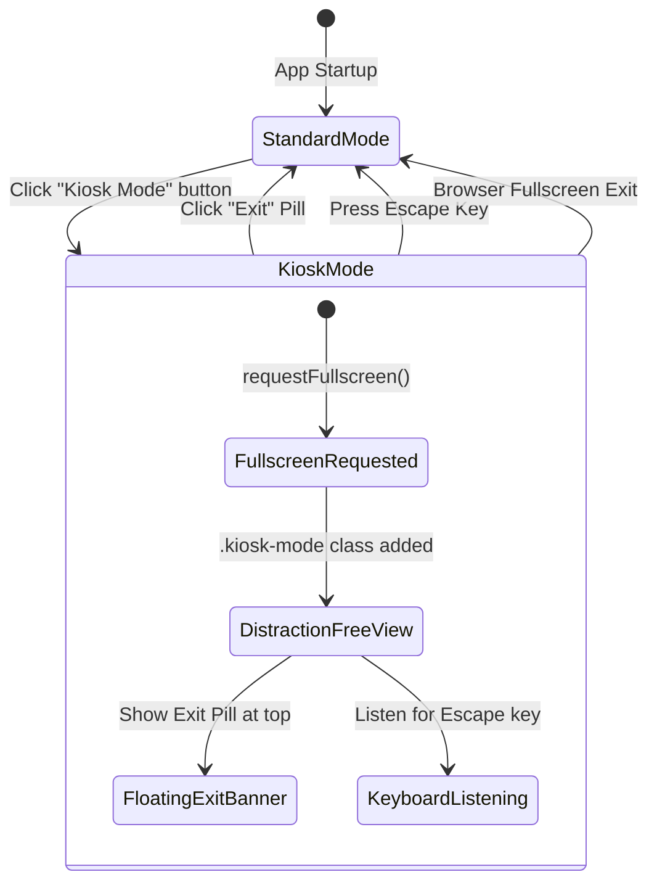

# SimpleGST — Kiosk Mode Implementation & Operational Report

**Document Version:** 1.0.0  
**Implementation Date:** November 5, 2026  
**Module:** Top Navigation Kiosk Controller & Distraction-Free Fullscreen Canvas  

---

## 1. Architectural Objective

Kiosk Mode provides a dedicated, simplified, distraction-free operating mode tailored for fast retail data entry, point-of-sale invoice recording, and dedicated tax audit review stations.

It removes non-essential navigation chrome, collapses vertical sidebars, expands the primary GST workspace across 100% of the display canvas, and leverages standard Web Fullscreen APIs.

---

## 2. Header Placement & Visual Design

As specified in Phase 3 directives, the Kiosk Mode trigger is positioned in the top global navigation bar **immediately adjacent to the Business Owner role selector**:

```
[🏢 Apex Retailers Pvt Ltd ▼] [📅 Oct 2026] ... [🖥️ Kiosk Mode] [👤 Business Owner ▼] [🔔] [🖼️ Profile]
```

### Markup Implementation:
```html
<!-- Kiosk Mode Toggle -->
<button id="btnToggleKiosk" onclick="toggleKioskMode()" 
  class="flex items-center gap-1.5 px-3 py-1.5 rounded-lg bg-surface hover:bg-surface-container border border-outline-variant text-on-surface font-label-sm text-xs font-medium cursor-pointer transition-colors shadow-xs" 
  title="Enter Kiosk Mode (Distraction-Free Fullscreen)">
  <span class="material-symbols-outlined text-[16px] text-primary">fullscreen</span>
  <span class="hidden sm:inline font-semibold">Kiosk Mode</span>
</button>
```

---

## 3. Behavioral Lifecycle & Interaction Flows



### 3.1 Entering Kiosk Mode
When `toggleKioskMode()` is invoked:
1. `appState.isKioskMode` is set to `true`.
2. The CSS class `kiosk-mode` is added to `document.body`.
3. The browser's native `document.documentElement.requestFullscreen()` API is triggered within a `try/catch` block, ensuring graceful degradation if permissions are restricted.
4. The floating Exit Banner (`#kioskExitBanner`) slides in from the top of the viewport.
5. An informative notification toast confirms activation: *"Kiosk Mode activated. Press Esc to exit."*

### 3.2 Floating Exit Banner
A floating pill is pinned at the top-center (`fixed top-4 left-1/2 -translate-x-1/2 z-50`):
```html
<div id="kioskExitBanner" class="fixed top-4 left-1/2 transform -translate-x-1/2 z-50 bg-slate-900/90 text-white backdrop-blur-md px-4 py-2 rounded-full shadow-2xl flex items-center gap-3 border border-slate-700/50">
  <span class="inline-flex items-center gap-1.5 font-label-sm text-xs text-emerald-400 font-semibold">
    <span class="w-2 h-2 rounded-full bg-emerald-400 animate-pulse"></span>
    Kiosk Mode Active
  </span>
  <span class="text-xs text-slate-300 hidden md:inline">Press <kbd class="px-1.5 py-0.5 rounded bg-slate-800 text-slate-200 font-mono text-[10px] border border-slate-600">Esc</kbd> or click to exit</span>
  <button onclick="exitKioskMode()" class="px-2.5 py-1 rounded-full bg-red-600 hover:bg-red-700 text-white font-label-sm text-xs font-semibold flex items-center gap-1 cursor-pointer transition-colors">
    <span class="material-symbols-outlined text-[14px]">fullscreen_exit</span>
    Exit
  </button>
</div>
```

### 3.3 Keyboard & Browser Fullscreen Synchronization
- **Escape Key:** A global `keydown` event listener monitors for `e.key === "Escape"`. If Kiosk Mode is active, `exitKioskMode()` is called immediately.
- **Native Fullscreen Event:** The `fullscreenchange` event checks if `document.fullscreenElement` becomes null (e.g. user pressed F11 or browser exit button) and synchronizes internal state.

---

## 4. Security & Tenant Context Preservation

1. **Zero Session Mutation:** Kiosk Mode mutates only visual layout classes. It does not alter active organization IDs, active GSTINs, tax period selections, or user privilege tiers.
2. **Permission Boundary:** Switching to Kiosk Mode does not unlock restricted administrative tabs or allow cross-tenant data inspection.
3. **No Private Data Exposure:** Data rendered in Kiosk Mode is strictly scoped to the active tenant session.
